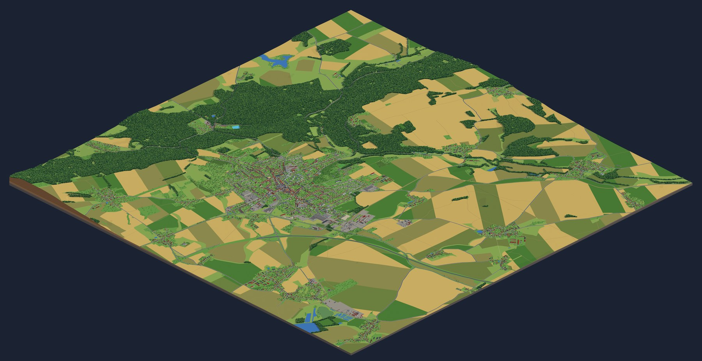

# Izometrické Hořice

Izometrická pixel-art mapa Hořic (okres Jičín) a okolí ve stylu SimCity 2000, postavená z otevřených dat.
Čtyři roční období, noc, počasí, klikací budovy s adresami, hledání a doprava.

**Živá mapa: [www.svamberk.net/horice](https://www.svamberk.net/horice/)**



Mapa vznikla nástrojem **[izomapa](https://github.com/adamklatovsky/izomapa)**, který napsal
[Adam Klatovský](https://www.adamklatovsky.cz/) (živá ukázka jeho Liberce je na [izomapa.fun](https://izomapa.fun)).
Tenhle repozitář je jeho fork s konfigurací Hořic, ručně doladěnými dominantami a několika úpravami nástroje
(seznam v [docs/ZMENY.md](docs/ZMENY.md)). Původní README nástroje je v [README-izomapa.md](README-izomapa.md).
Když vám izomapa ušetřila práci, autor nástroje bude rád za [kafe ☕](https://donate.stripe.com/3cI6oA0PE7u65Y9cim8g000).

## Co v mapě je

- **Území:** 3 × 3 čtverce po 2,3 km (asi 6,9 × 6,9 km) – Hořice, Hořický chlum a okolní vesnice
  (Chlum, Dobrá Voda, Jeřice, Březovice, Libonice, Dachovy, Chvalina…).
- **Automaticky z dat:** všechny budovy z OpenStreetMap, jejich výšky a tvar střech z laserového skenování ČÚZK,
  les podle ortofota, pole a louky ze ZABAGED, silnice včetně dálnice **D35** (hotový úsek od Hradce Králové
  ke sjezdu Hořice; úsek ve výstavbě se nekreslí), mosty, auta, lampy, sochy, obchody v přízemí (Overture Places).
- **Barvy střech** všech budov z ortofota ČÚZK, **barvy fasád** asi 280 domů z volně licencovaných fotek ulic
  na Wikimedia Commons ([docs/ZDROJE-FASAD.md](docs/ZDROJE-FASAD.md)).
- **Otáčení mapy** po 90° (pohled od jihozápadu, severozápadu, severovýchodu a jihovýchodu), střelka ukazuje sever.
- **Ručně doladěné dominanty** (25 staveb, [assets/dominanty.json](assets/dominanty.json)) podle fotek
  z Wikimedia Commons, laseru ČÚZK a Památkového katalogu, např.:
  kostel Narození Panny Marie, radnice s věžičkou, bývalá spořitelna, Masarykova věž samostatnosti,
  kostel sv. Gotharda, Riegrův obelisk, Mariánský sloup, zámek s tvrzí, městské muzeum, sochařsko-kamenická škola,
  synagoga, gymnázium, Goldschmidtova vila, pivovar a komíny, ocelová rozhledna na Hořickém chlumu,
  kostel a zámek v Jeřicích, koupaliště Dachova a další.
  Zdroje fotek s autory a licencemi: [docs/ZDROJE-FOTEK.md](docs/ZDROJE-FOTEK.md),
  ověřená fakta o stavbách: [docs/dominanty-podklady.md](docs/dominanty-podklady.md).

> **Mapa není digitální dvojče.** Otevřená data mají chyby a část detailů (stromy, auta, lampy, barvy obyčejných domů)
> se doplňuje podle pravidel (fasády bez fotky mají barvu podle typu domu). Známé chyby a nápady na zlepšení jsou v [docs/KONTROLA.md](docs/KONTROLA.md).

## Jak přispět

Oprava nebo doplnění je vítané – hlavně od lidí, kteří Hořice znají. Postup je v [CONTRIBUTING.md](CONTRIBUTING.md),
ve zkratce:

1. **Chyba v datech** (chybí dům, špatná cesta, rybník, les): nejlepší je opravit ji přímo
   v [OpenStreetMap](https://www.openstreetmap.org/) – pomůže to všem a do mapy se propíše při další stavbě.
2. **Dominanta** (kostel, věž, výrazná stavba): úprava v [assets/dominanty.json](assets/dominanty.json)
   podle vlastních fotek nebo volně licencovaných fotek (Wikimedia Commons). **Nikdy neobkreslujte z Google Maps,
   Apple Maps ani Mapy.cz** – jejich podmínky to zakazují.
3. **Pull request** s popisem a výřezem před/po. Každou změnu před sloučením zkontroluje správce repozitáře.

## Jak mapu postavit

Potřebujete Python 3.9+, Node 18+, Git (na Windows Git Bash) a počítač s grafickou kartou.
Stavba celé mapy trvá zhruba hodinu (vyzkoušeno na Windows 11 s NVIDIA Quadro P4000), data mají jednotky GB.

```sh
git clone https://github.com/svamberk/izometricke-horice.git
cd izometricke-horice
```

**macOS / Linux:** `./setup.sh`

**Windows (Git Bash):**
```sh
python -m venv .venv
.venv/Scripts/python -m pip install shapely pyproj numpy pillow pyarrow pandas "laspy[lazrs]"
npm install
npx playwright install chromium
```

Pak (všude):
```sh
./postav.sh            # stáhne data a postaví celou mapu do složky site/
./postav.sh render     # po úpravě dominant nebo pravidel: jen scény, render a web
./postav_pohledy.sh    # otočené pohledy (od SZ, SV, JV) do site/p1..p3/ – pro tlačítka otáčení mapy, ~1 h na pohled
```

Náhled: `.venv/Scripts/python -m http.server --bind 127.0.0.1 -d site 8000` (na Macu/Linuxu `.venv/bin/python`)
a otevřít <http://localhost:8000>.

Rychlá zkouška jedné dominanty bez celé stavby: `python nastroje/dom_info.py <název> <lat> <lon>` ukáže půdorys,
laserové výšky a ortofoto místa, `python nastroje/qa_tools.py vyrez <i,j> summer <lat> <lon>` vyřízne render.
Návod pro AI agenty (Claude Code, Codex) je v [CLAUDE.md](CLAUDE.md).

## Zveřejnění

Výsledek je statická složka `site/` (asi 0,8 GB a 3 600 souborů na jeden pohled, se čtyřmi pohledy pro otáčení
asi 3 GB), stačí ji nahrát na libovolný webhosting.
Pro FTP hosting (např. WEDOS, který vyžaduje šifrované spojení se znovupoužitím relace) je tu
[nastroje/ftp_nahraj.py](nastroje/ftp_nahraj.py) – nahrává několika spojeními, po přerušení pokračuje
a `index.html` nahraje až nakonec. Přihlašovací údaje bere ze souboru netrc, heslo nikde nevypisuje.

## Data a licence

| zdroj | co z něj je | licence |
|---|---|---|
| [OpenStreetMap](https://www.openstreetmap.org/copyright) přes [Overture Maps](https://overturemaps.org/) | budovy, adresy, ulice, voda, využití území | ODbL – © přispěvatelé OpenStreetMap |
| [ČÚZK](https://geoportal.cuzk.cz/): DMP 1G, ortofoto, ZABAGED | výšky budov, barvy střech, les, pole a louky | CC BY 4.0 – © ČÚZK |
| [Terrarium](https://registry.opendata.aws/terrain-tiles/) (AWS Open Data) | terén | s uvedením zdroje |
| [Wikimedia Commons](https://commons.wikimedia.org/) | fotky jako předloha dominant a barev fasád (v repozitáři nejsou) | dle jednotlivých fotek, viz [docs/ZDROJE-FOTEK.md](docs/ZDROJE-FOTEK.md) a [docs/ZDROJE-FASAD.md](docs/ZDROJE-FASAD.md) |

Kód je pod licencí **AGPL-3.0** jako původní izomapa (soubor [LICENSE](LICENSE)): kdo ho upraví a pustí jako web,
musí zveřejnit i svoje úpravy. Patička nápovědy v mapě se zdroji dat a odkaz „Vytvořeno nástrojem izomapa“ musí zůstat.
